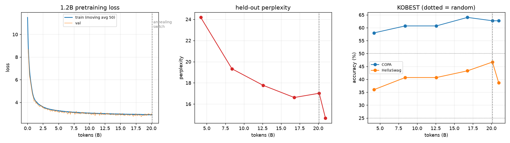

# bebut — 한국어 1.2B LLM을 밑바닥부터

[](https://github.com/concrete-sangminlee/bebut/actions/workflows/ci.yml)
[](LICENSE)
[](https://www.python.org/)
[](https://pytorch.org/)
[](README.md)

**[🔗 사이트에서 보기](https://concrete-sangminlee.github.io/bebut/)**

토크나이저부터 직접 만들어 **한국어 1.2B 대화 모델**을 완성한 기록입니다.
`transformers` 없이 순수 PyTorch로 구현했고, GPU 한 장(RTX 6000 Ada 48GB)에서
**25.2B 토큰**을 학습한 뒤 SFT까지 마쳤습니다.

| | |
|---|---|
| 모델 | decoder-only 1.2B (dim 2048 / 24층 / GQA 16:4 / ctx 2048) |
| 토크나이저 | byte-level BPE 64K, 한국어 코퍼스로 직접 학습 |
| 사전학습 | 25.2B 토큰 (24,000 step, RTX 6000 Ada ×1, 약 6주) |
| 정렬 | SFT (KoAlpaca + KULLM v2, 2 epoch) |
| 최종 | `checkpoints/sft_1b/latest.pt` |



<sub>사전학습 loss(step 19,200까지)와 마일스톤 평가(step 20,000까지). annealing 구간은 로그가 없어 빠졌고, KOBEST는 채점 버그 이전 † 값입니다.</sub>

## 결과 요약

> **⚠️ KOBEST 수치 정정 필요 (2026-11).** 아래 KOBEST 점수(†)는 **선택지의 첫 토큰을
> 채점에서 빠뜨리는 버그**가 있는 채점기로 측정했습니다. 문맥 끝 공백(`"답: "`)이 선택지
> 첫 단어에 붙어 토큰화되는데(`" 예"`), 경계를 문맥만 따로 토큰화한 길이로 잡았기 때문입니다.
> 특히 **BoolQ는 모델을 측정한 적이 없습니다** — `"예"`는 채점 토큰이 0개였습니다.
> 버그는 고쳤고(회귀 테스트 포함) 재측정은 체크포인트가 있는 서버에서
> `python final_eval.py`, `python sft_eval.py`로 합니다.
> 경위와 영향은 [docs/RESULTS.md §0](docs/RESULTS.md#0-채점-버그-정정-2026-11)에 있습니다.
> perplexity와 대화 평가는 이 버그와 무관합니다.

**사전학습 (1.2B vs 같은 코드로 학습한 125M)**

| | 125M (2.6B 토큰) | **1.2B (25.2B 토큰)** | 무작위 |
|---|---|---|---|
| val perplexity ‡ | 34.0 | **13.87** | — |
| KOBEST COPA † | 48.3% | **67.1%** | 50% |
| KOBEST HellaSwag † | 28.3% | **40.0%** | 25% |
| KOBEST BoolQ † | 49.3% | 50.0% | 50% |

**SFT 후 (SFT 데이터와 겹치지 않는 자체 문항 + KOBEST 전체)**

| | 대화 정답률 | 스스로 멈춤 | 반복 루프 | COPA † | HellaSwag † |
|---|---|---|---|---|---|
| 베이스 | 66.7% | 92% | 11% | 67.1% | 40.0% |
| SFT 에폭0 | 63.3% | 100% | 3% | 66.9% | 40.8% |
| **SFT 최종** | **70.0%** | 97% | 8% | 66.4% | 40.8% |

† 첫 토큰 누락 버그가 있는 채점기로 측정 — 재측정 전까지 참고값입니다.
‡ 1.2B 값은 held-out이 아닙니다. val 문서의 76%(위키·영어 Edu)를 annealing이 다시 학습했습니다. 완전한 held-out은 annealing 직전의 18.84까지입니다([RESULTS §2 정정](docs/RESULTS.md#2-annealing-효과-전체-문항-gpu-같은-조건--kobest-)).

유형별로는 **사실 100%, 지시 33%, 계산 0%**입니다. 자세한 수치와 해석은
[docs/RESULTS.md](docs/RESULTS.md), 모델별 답변 전문은
[logs/sft_eval_answers.md](logs/sft_eval_answers.md)에 있습니다.

```
Q: 조선을 건국한 사람은 누구야?
A: 조선은 이성계라는 인물이 건국한 나라입니다. 이성계는 고려 말기의 권문세족으로,
   이성계의 아버지 이자춘은 공민왕, 이성계의 형인 이원계는 우왕, ...
   → 핵심(이성계)은 맞히지만 세부는 그럴듯하게 지어냅니다

Q: 'Good morning'을 한국어로 번역해줘.
A: "굿모닝"은 "좋은 아침"으로 번역할 수 있습니다.

Q: 6 곱하기 7은 얼마야?
A: 6 곱하기 7의 결과는 28입니다.
   → 계산은 전혀 못 합니다
```

## 모델 쓰기

```bash
# 터미널 대화 — 토큰이 나오는 대로 출력, 긴 대화는 오래된 턴부터 잘라 넣음
python sample.py --ckpt checkpoints/sft_1b/latest.pt --chat --repetition-penalty 1.1

# OpenAI 호환 API 서버 + 웹 채팅 UI (http://127.0.0.1:8000)
python serve.py --ckpt checkpoints/sft_1b/latest.pt

# HuggingFace 형식(Qwen3ForCausalLM 호환)으로 내보내기 → transformers · vLLM
python export_hf.py --ckpt checkpoints/sft_1b/latest.pt --out hf/bebut-1.2b-sft

# GGUF로 내보내기 → llama.cpp · Ollama · LM Studio (Q8_0이면 1.2B가 1.27GB)
python export_gguf.py --ckpt checkpoints/sft_1b/latest.pt --out gguf/bebut-1.2b-sft.gguf --type q8_0
cd gguf && ollama create bebut -f Modelfile && ollama run bebut
```

**CPU에서는 GGUF Q8_0 + llama.cpp가 가장 빠릅니다** — 1.2B 실측(4코어) 16.4 tok/s로 PyTorch fp32
(8.2)의 2.0배입니다. PyTorch 경로도 bf16 명령이 있는 CPU에선 자동으로 bf16(12.1 tok/s)을 씁니다.
측정 전체와 권장 구성은 [docs/INFERENCE.md](docs/INFERENCE.md)에 있습니다.

대화 CLI와 서버는 **턴 사이에 KV 캐시를 재사용**합니다. 매 턴 기록 전체를 다시 계산하지 않고
지난 턴과 달라진 부분만 prefill하므로, 대화가 길어져도 첫 토큰까지의 시간이 늘지 않습니다
(1.2B, CPU 4코어, 기록 1,060토큰에서 첫 토큰까지 2.04초 → 0.27초). 기록이 문맥 창을 채운
뒤에는 오래된 턴을 user 턴 경계에서, 창의 1/4 단위로 묶어 버립니다. 그래서 자르는 자리가 몇
턴씩 유지되고 그동안 캐시가 계속 재사용됩니다(80턴 모의 대화에서 창이 찬 뒤 턴당 새로 계산하는
토큰 1,720 → 276). fp32에선 출력이
캐시 없이 생성한 것과 토큰 단위로 같습니다. bf16(CUDA·bf16 지원 CPU의 기본)에선 반올림 차이로 드물게 달라질 수
있어, 완전한 재현이 필요하면 `--no-prefix-cache`로 끕니다.

API 서버는 `/v1/chat/completions`(SSE 스트리밍 포함)·`/v1/completions`·`/v1/models`를
제공해서 openai SDK, LangChain, Open WebUI 등이 `base_url`만 바꿔 붙습니다. 표준 라이브러리만
씁니다. 생성 옵션은 temperature · top-p · top-k · min-p · repetition penalty · stop 문자열 · seed.

```python
from openai import OpenAI
client = OpenAI(base_url="http://127.0.0.1:8000/v1", api_key="unused")
r = client.chat.completions.create(model="bebut", messages=[{"role": "user", "content": "안녕?"}])
```

HF 내보내기가 가능한 이유는 이 모델의 구성(RMSNorm · RoPE · GQA · QK-Norm · SwiGLU · tying)이
Qwen3와 정확히 같아서입니다. 차이는 RoPE 차원 짝짓기 방식뿐이라 q/k 가중치 행 재배열로
해결하고, `transformers`로 읽어 logits 일치(오차 ~5e-5)·토크나이저 일치를 CI에서 검증합니다.
GGUF도 같은 재배열로 llama.cpp의 qwen3 아키텍처에 맞추고, **llama.cpp로 실제 추론해**
logits(F32 오차 ~6e-5)와 토큰화(약 330개 문자열 전부 일치)를 CI에서 대조합니다.
GGUF는 직접 씁니다 — llama.cpp의 변환 스크립트는 직접 학습한 토크나이저를 "알 수 없는
pre-tokenizer"로 거부하기 때문입니다.

## 표준 한국어 벤치마크

KOBEST에 더해 다른 한국어 모델과 나란히 놓을 수 있는 **KMMLU**(45과목 전문 지식, 과목별
dev 5문항으로 5-shot)와 **HAE-RAE Bench 1.0**(한국 문화·역사·어휘·독해 6범주)을 잽니다.
`final_eval.py`가 기본으로 함께 돌리고, 결과에는 과목별 점수와 과목 평균(macro)이 남습니다.

- 형식 두 가지: `cloze`(기본 — 선택지 **내용**의 로그확률을 비교)와 `mc`(보기를 A~D로 나열하고
  **문자**를 비교 — KMMLU 논문·리더보드와 같은 형식). 1B급 모델은 mc 형식에서 거의 무작위
  수준이라 cloze가 신호를 더 남기고, 다른 모델의 공개 점수와 비교할 때는 mc를 씁니다.
- 프롬프트가 문맥(2048)을 넘으면 앞쪽(few-shot 예시부터)을 잘라 채점하고 잘린 수를 기록합니다.
- **오염 검사**: 한국어 학습 데이터 전체(SFT · 교과서 · 위키백과 · 나무위키 · FineWeb-2 웹,
  6,441만 행)를 4만 문항과 대조했습니다. SFT · 교과서에는 오염이 없었습니다. KMMLU 678문항(1.9%)은
  사전학습 웹의 자격시험 기출 페이지에 문제 · 정답이 그대로 있었습니다. 오염 687문항은 빼고
  채점하고, 뺀 문항은 따로 채점해 기억 효과를 잽니다. BoolQ 지문의 85%는 위키백과 · 웹에서
  이미 봤습니다(질문은 깨끗)
  ([RESULTS §8](docs/RESULTS.md#8-벤치마크-오염-검사), `python -m evals.contamination`).
- 실제 데이터(HF `HAERAE-HUB/KMMLU`, `HAERAE-HUB/HAE_RAE_BENCH_1.0`, `skt/kobest_v1`)에서
  전 과목·전 범주가 로드·채점되는 것을 확인했고, CI는 같은 스키마의 가짜 행으로 검사합니다
  (`BEBUT_NET_TESTS=1`이면 실제 데이터로).

## 다음 단계: 계산 보완 · DPO

```bash
# 계산 약점(0%) 보완 실험 — 풀이를 보여주는 산술 대화 2만 개를 SFT에 섞는다
python -m data.make_math_sft --n 20000 --out data/math_sft.jsonl
python sft.py --base checkpoints/base_1b/latest.pt --config sft_1b --extra-data data/math_sft.jsonl
python sft_eval.py --questions evals/math_heldout_ko.json --skip-kobest --models 최종=checkpoints/sft_1b/latest.pt

# DPO — 같은 질문의 좋은 답·나쁜 답 쌍으로 선호를 학습 (prefs.jsonl은 직접 준비)
python dpo.py --base checkpoints/sft_1b/latest.pt --config dpo_1b --data prefs.jsonl
```

- **산술 데이터**는 `47 + 38 = (40 + 30) + (7 + 8) = 70 + 15 = 85`처럼 자리별 풀이를 보여주고,
  한국어 조사를 숫자 읽기에 맞춥니다(7**은**, 4**로**, 100**을**). 평가셋
  `evals/math_heldout_ko.json`(200문항)은 학습 데이터와 **(연산, 피연산자) 조합이 겹치지 않게**
  해시로 나눴고, 기존 held-out 계산 5문항의 조합은 학습에서 뺍니다. 추가 데이터는 학습 쪽에만
  붙어 val 분할은 예전과 같습니다. 효과는 아직 측정하지 않았습니다.
- **DPO**는 SFT 모델을 참조 모델로 두고(참조 로그확률은 학습 전에 한 번 계산) `-log σ(β·[(log π − log π_ref)(chosen) − (…)(rejected)])`를
  최소화합니다. 시작 loss가 정확히 ln 2인지, 로그확률·gradient가 직접 계산한 값과 같은지,
  실제 학습에서 선호가 생기는지를 테스트로 확인합니다. 데이터는 `{"prompt", "chosen", "rejected"}`,
  멀티턴 `messages`, UltraFeedback-binarized 형식 JSONL 또는 `hf:<데이터셋>`.

## 무엇을 직접 만들었나

`datasets`(코퍼스 다운로드)와 PyTorch(행렬 연산·자동미분)를 빼면 전부 이 저장소 안에 있습니다.

- **BPE 토크나이저** — 증분 쌍 빈도 갱신 + inverted index + lazy-deletion heap으로
  500MB 코퍼스에서 64K vocab을 18.6분에 학습 ([tokenizer/bpe.py](tokenizer/bpe.py)).
  학습에 안 쓴 한국어 웹 텍스트에서 **글자/토큰 2.51** — GPT-4o 1.65, EXAONE 3.5 1.90,
  Qwen2.5 1.46보다 같은 글을 적은 토큰으로 담는다 ([비교](docs/RESULTS.md#7-토크나이저-효율),
  [tokenizer/compare.py](tokenizer/compare.py))
- **트랜스포머** — RMSNorm · RoPE · GQA · QK-Norm · SwiGLU · embedding tying.
  교육용 명시적 attention과 FlashAttention 경로를 모두 두고 단위테스트로 일치 검증
  ([model.py](model.py))
- **청크 cross-entropy** — 64K vocab에서 logits만 8.6GB가 되는 문제를
  gradient checkpointing으로 해결 ([model.py](model.py)의 `chunked_cross_entropy`)
- **데이터 파이프라인** — 스트리밍 다운로드 → 품질 필터 → MinHash 중복제거 →
  토크나이즈 → shard ([data/](data/))
- **품질 분류기** — 위키·교과서를 positive, 원본 웹을 negative로 학습한 해시 특징
  로지스틱 회귀(numpy 직접 구현), held-out 정확도 98.3% ([data/quality.py](data/quality.py))
- **학습 루프** — WSD 스케줄, bf16, torch.compile, gradient accumulation,
  원자적 체크포인트, 비트 단위로 같은 재개(e2e 테스트로 검증), NaN step 건너뛰기,
  에폭 기반 셔플 ([train.py](train.py), [data/dataloader.py](data/dataloader.py))
- **추론** — 미리 할당한 KV 캐시, GQA 디코드에서 K·V 복사 없는 SDPA, 스트리밍,
  top-k/min-p/반복 억제 ([model.py](model.py)), 증분 UTF-8 디코딩 ([chat.py](chat.py))
- **서빙** — OpenAI 호환 HTTP 서버와 웹 UI를 표준 라이브러리로, 요청 사이 KV 캐시 재사용
  ([serve.py](serve.py), [web/](web/))
- **내보내기** — safetensors·HF tokenizer.json ([export_hf.py](export_hf.py)), GGUF v3와
  Q8_0 양자화 ([export_gguf.py](export_gguf.py))를 직접 구현
- **DPO** — 참조 모델 대비 선호 학습, 응답 위치만 청크 단위 lm_head ([dpo.py](dpo.py))
- **평가** — perplexity·bits-per-byte, KOBEST·**KMMLU(45과목)·HAE-RAE Bench(6범주)**
  (바이트 오프셋 기반 선택지 경계, 배치 채점, 비조건부 정규화, 예측 쏠림 감지, 긴 문맥 왼쪽 자르기),
  오염 검사 ([eval.py](eval.py), [evals/](evals/))

## 전체 재현 절차

```bash
python3.13 -m venv .venv && source .venv/bin/activate
pip install -r requirements.txt

# 0) 구현 검증 (GPU 불필요, 1분)
python -m tokenizer.test_bpe      # BPE 왕복·압축률
python test_model.py              # attention 일치, 초기 loss=ln(V), 오버핏, KV 캐시, 청크 CE
pip install pytest && python -m pytest   # 추론·채점·재개·SFT·DPO·서버 e2e 등 (CPU 1분)

# 1) 토크나이저 (약 20분, CPU 다중코어)
python -m tokenizer.train_tokenizer --sample-mb 500 --vocab-size 65536

# 2) 데이터 (약 2시간, 디스크 45GB)
python -m data.prepare --tokens 26e9 --workers 40

# 3) 품질 분류기 + annealing 데이터 (약 2시간, 디스크 9GB)
python -m data.train_quality --n 8000
python -m data.prepare_anneal --tokens 5.2e9 --workers 40

# 4) 사전학습 (RTX 6000 Ada 1장 기준 약 6주)
./run_training.sh base_1b data/shards_26b        # 죽으면 자동 재개
./watch_milestones.sh &                          # 스냅샷 생길 때마다 자동 평가

# 5) 평가 — perplexity·BPB + KOBEST + KMMLU(5-shot) + HAE-RAE (오염 문항 제외)
python final_eval.py --exclude-ids evals/contaminated_ids.json   # → logs/final_eval_v2.json
python eval.py --ckpt checkpoints/base_1b/latest.pt --bench kmmlu --format mc   # 리더보드 형식

# 6) SFT (약 5.5시간) — 에폭마다 epoch{n}.pt도 남긴다
python sft.py --base checkpoints/base_1b/latest.pt --config sft_1b
python sft_eval.py

# 6.5) (선택) 산술 보완 SFT, DPO — 위 "다음 단계" 참고

# 7) 대화 · 서빙 · 내보내기
python sample.py --ckpt checkpoints/sft_1b/latest.pt --chat
python serve.py --ckpt checkpoints/sft_1b/latest.pt
python export_hf.py --ckpt checkpoints/sft_1b/latest.pt --out hf/bebut-1.2b-sft
python export_gguf.py --ckpt checkpoints/sft_1b/latest.pt --out gguf/bebut-1.2b-sft.gguf
```

작은 규모로 먼저 검증하려면 `--config debug_30m`(노트북) 또는 `mid_125m`(GPU 반나절)을
쓰세요. 서버 운영·재개·모니터링은 [docs/OPERATIONS.md](docs/OPERATIONS.md)에 있습니다.

## 저장소 구조

```
model.py                 트랜스포머 (RMSNorm/RoPE/GQA/QK-Norm/SwiGLU) + 청크 CE + KV 캐시·스트리밍 생성
train.py                 사전학습 루프 (WSD, bf16, compile, annealing 전환, 원자적 체크포인트, --stop-after)
sft.py                   SFT (assistant 토큰만 loss, 토큰 가중 누적, 길이별 묶음, --data JSONL)
chat.py                  대화 템플릿 단일 정의 (학습·추론·평가 공유) + 스트리밍 디코더
sample.py                생성 / --chat 스트리밍 대화
serve.py, web/           OpenAI 호환 API 서버 + 웹 채팅 UI (표준 라이브러리)
dpo.py                   DPO 선호 학습 (참조 모델 고정, 응답 토큰 로그확률)
export_hf.py             HuggingFace(Qwen3) 형식 내보내기
export_gguf.py           GGUF(llama.cpp·Ollama) 내보내기 + Modelfile
eval.py                  perplexity + KOBEST (선택지 경계 정확 채점, 비조건부 정규화, 예측 쏠림 감지)
final_eval.py            사전학습 최종 평가 (annealing 전/후 비교)
sft_eval.py              SFT 평가 (자체 문항 + KOBEST)
bench.py                 처리량·VRAM 벤치마크
test_model.py            모델 검증 6종
tests/                   pytest — 추론, 채점 회귀, 데이터로더, 학습·SFT·DPO e2e, 서버, CLI, HF·GGUF 내보내기

tokenizer/               byte-level BPE 구현·학습·테스트 + 학습된 64K vocab
data/                    다운로드·정제·중복제거·품질분류·토크나이즈·데이터로더·산술 SFT 생성기
configs/                 debug_30m · mid_125m · base_1b · sft_1b (+ 스모크·CI용)
evals/                   자체 평가 문항(대화 36 · 산술 200) + 벤치마크 오염 검사(n-gram)
docs/                    결과 정리, 운영 가이드, 추론 가이드(실측), 그래프
logs/                    학습 곡선, 마일스톤, 평가 결과 원본
```

체크포인트(모델당 14GB)와 데이터 shard(54GB)는 용량상 저장소에 없습니다.

## 하드웨어와 비용

RTX 6000 Ada 48GB **한 장**으로 전부 했습니다. 벤치마크로 고른 설정은
마이크로배치 2 × 2048토큰(26GB)이며, 처리량은 11K tok/s였습니다.

벤치마크(`bench.py`, compile 없이)에서 배치 4는 10.3K tok/s로 배치 2(6.8K)보다 40% 빨랐지만
VRAM이 34.7GB로 늘어, 같은 GPU를 쓰는 다른 작업(vLLM 등)이 뜰 때마다 OOM으로 죽었습니다.
**공유 자원에서는 최적값보다 완주 가능성이 중요**하다는 판단으로 배치 2를 택했고, 실제
학습에서는 torch.compile 덕에 배치 2로도 10~11K tok/s가 나와 벤치마크의 배치 4와 비슷했습니다.

## 한계

- **계산 불가** — 12+7을 14라고 답합니다. SFT 데이터에 정답이 붙은 산수가 거의 없던 탓으로 보고,
  합성 산술 데이터로 보완하는 실험을 준비해 뒀습니다(위 "다음 단계" — 효과는 미측정).
- **드문 사실은 지어냅니다** — 산 높이, 화학식 같은 수치는 매번 다르게 답합니다.
- **BoolQ는 미확인** — 전 구간 무작위 수준·한쪽 쏠림으로 기록했지만, 이는 채점 버그
  (`"예"`의 채점 토큰 0개)로 설명됩니다. 고친 채점기로 재측정해야 실제 능력을 알 수 있습니다.
- **annealing의 부작용(재확인 필요)** — 고품질 데이터 전환으로 perplexity는 26% 좋아졌다고 적었지만(val의 76%를 annealing이 다시 학습해 과대평가 — RESULTS §2)
  HellaSwag은 46.2% → 40.0%로 떨어졌습니다. 웹의 서사 텍스트를 너무 줄인 탓으로 봤지만,
  이 비교도 버그 있는 채점기로 잰 값이라 재측정 후에 결론을 내려야 합니다.
- **SFT 데이터 오염** — annealing에 SFT와 같은 데이터를 넣어 SFT 검증 loss가
  일반화가 아니라 기억을 재고 있었습니다. 그래서 별도 문항을 만들어 평가했습니다.

자세한 내용과 그 과정에서 배운 것은 [docs/RESULTS.md](docs/RESULTS.md)에 정리했습니다.
